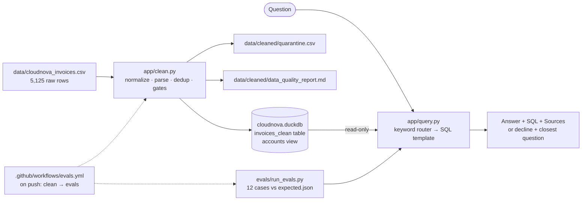

# CloudNova revenue Q&A

Ask plain-English questions about CloudNova's invoice ledger and get an answer you can check: every answer comes with the exact SQL that produced it and the number of rows behind it. If a question is outside what the system can answer reliably, it says so instead of guessing.

1. **Cleaning pipeline:** turns the messy export (5,125 rows with duplicates, mixed date formats, `"$4,900.00"` strings, many spellings of "paid") into one row per invoice. It publishes nothing unless the result matches the expected counts.
2. **Question router:** matches your question to one of six reviewed SQL templates, fills in year / plan / top-N / status, and runs it read-only.

## Setup and the two commands

Requires Python 3.12 (the version CI runs).

```bash
python -m venv .venv && source .venv/bin/activate
pip install -r requirements.txt          # pandas + duckdb only; no API keys

python -m app clean                       # build the clean database, print the data-quality report
python -m app ask "How much have we given back in refunds?"
```

`ask` prints the answer, the SQL (`Query:`) and the row count (`Sources:`). Exit code: 0 answered, 2 declined, 1 error (e.g. `clean` not run yet). Evals: `python evals/run_evals.py`. Settings live in [`app/config.py`](app/config.py); `RAW_CSV`, `DB_PATH`, `CLEANED_DIR` and `AS_OF_DATE` can be overridden by environment variables or a `.env` (copy [`.env.example`](.env.example)).

## The rules (specs)

The specs were written first and are the source of truth: [`schema.md`](specs/schema.md) (cleaning, gates, metrics), [`api.md`](specs/api.md) (commands, router), [`evals.md`](specs/evals.md) (test cases). In short:

- **Revenue** = USD amounts on `paid` invoices. **Refunds** = `refunded` invoices. **Exposed $** = `pending` + `failed`.
- **USD** = local amount × fixed FX (EUR 1.08, GBP 1.27). **MRR** = list price × seats × (1 − discount), monthly or annual.
- **Gates:** 5,125 rows → minus 82 exact and 43 near-duplicates → exactly 5,000 invoices, 3,815 accounts, no missing key fields, negatives only on refunds. Any failure → nothing written.

## How it fits together

Component-by-component table: [`docs/architecture.md`](docs/architecture.md).



## The six stakeholder questions

| Question | Answer |
|---|---|
| Recognized revenue (paid) in 2024 | **$32,686,371.05** from 891 invoices (20 have ambiguous dates; the answer says so) |
| Region with the highest average MRR per account | **APAC, $6,147.30** (NA $5,632.84 · EMEA $5,327.66 · LATAM $5,187.55), active accounts only |
| Refunds given back | **$8,925,163.77** across 292 invoices |
| Churn rate, Enterprise vs Starter | **21.92%** (171 of 780) vs **18.81%** (354 of 1,882) |
| Top 5 accounts by revenue, flag CSAT ≤ 2 | ACC-7509 Stark Inc $1,210,592.75 · ACC-1420 Tyrell Industries · ACC-9946 Initech LLC · ACC-1196 Pied Piper Partners · ACC-5211 Oscorp Industries. **None has CSAT ≤ 2** |
| Invoices stuck in pending/failed | **894 invoices, $28,983,255.81 exposed** (498 pending, 396 failed) |

## Evals

12 cases against [`evals/expected.json`](evals/expected.json) (tolerance $0.01 / 0.1 pp; counts and IDs exact):

| Group | Cases | Result |
|---|---|---|
| The six questions above | 6 | 6 PASS |
| Reworded / re-parameterized ("book in 2023", "top 3", "churn for Pro") | 3 | 3 PASS |
| CSAT flag shows up (top 15 → ACC-5925 flagged) | 1 | PASS |
| "What was revenue last quarter in EUR?" is declined | 1 | PASS |
| "Which industry brings in the most paid revenue?" | 1 | **XFAIL** (expected) |

**Why the XFAIL:** the data can answer it (Gaming, $12,979,507.52), but no template groups by industry, so the router declines. A missing template produces "I can't answer that", not a wrong number. Only a real FAIL fails the run.

## Design decisions

- **Duplicate invoice IDs: the most final status wins** (refunded > void > paid > failed > pending; then latest date). A refund or void happens after a payment, so it's the more current fact. 27 of the 43 pairs differed only in status spelling.
- **Dates:** slash dates are MM/DD/YYYY (none starts above 12); dash dates are DD-MM-YYYY (151 of 239 start above 12). Dash dates with both parts ≤ 12 are kept and flagged `date_ambiguous`.
- **Latest invoice wins** for an account's plan, seats, region, churn, CSAT and MRR; revenue sums all its paid invoices.
- **Templates instead of a live LLM:** same question, same answer, auditable SQL, no API key. The cost is coverage.
- **Fail closed:** nothing is written unless every gate passes, the database is swapped in one step, values with no spec rule stop the run, and queries open the database read-only.

## Limitations — read before trusting a number

- **FX direction (open question for finance).** EUR/GBP amounts look already converted from the USD list price, so applying 1.08 / 1.27 again likely overstates them by ~17% / ~61% (1,048 EUR and 476 GBP invoices). We follow the briefing until finance confirms.
- **Ambiguous dates.** 87 invoices could be DD-MM or MM-DD; 61 are paid ($1,584,382.67), 20 of them in 2024 revenue. Year totals shift if the rule is wrong.
- **Account names.** 976 account IDs carry more than one name; the ID is the key, the name comes from the latest invoice.
- **Future-dated invoices count as revenue.** 106 invoices are dated after 2026-11-15 and kept (flagged). 71 are paid ($1,628,446.73) and count in all-years, 2026 and 2027 revenue and in account rankings, not 2024.
- **Refunds aren't netted from revenue**, per the metric definition; "net revenue" is declined.
- **Router coverage is narrow.** One calendar year (revenue only), plan (churn), top N ≤ 100, pending/failed. Other currencies, relative dates, months/quarters, other breakdowns and "lowest" rankings are declined. Matching is keyword-based, so odd phrasing may be declined or, rarely, mis-routed; the printed SQL shows which.
- **Missing CSAT isn't flagged:** no score shows `n/a`, not low (e.g. ACC-1420, #2 by revenue).

## With another day

- **LLM-to-SQL** for questions outside the templates, guarded: read-only connection, one `SELECT` only, allow-listed tables, same SQL + sources output, same eval harness.
- **Confirm FX direction** with finance and fix the conversion if needed.
- **Account master data** (one authoritative name, plan, churn status) instead of latest-invoice-wins.
- **Resolve ambiguous and future dates** with the source-system owner.
- **Recompute `expected.json` from the raw CSV** without `app/`, so the eval check is reproducible.

## How this was built

The data was profiled and the specs in `specs/` were committed **before any code** (`7415583`). The pipeline, router and eval harness were then generated from the specs with **Claude Code**, steered by [`CLAUDE.md`](CLAUDE.md): specs are the source of truth, pandas + DuckDB only, config over hard-coding, gates never lowered, `expected.json` never edited to pass, unclear spec → stop and ask.

That last rule fired once: the first run stopped because 27 duplicate invoice IDs tied on status and date, which the spec doesn't break. The tied rows were identical once cleaned, so a tie is now accepted only when rows match. The commit history shows each step; the prompts and decision points are in [`docs/prompt-log.md`](docs/prompt-log.md).

## Submission status

| Deliverable | Status |
|---|---|
| README | Done (this file) |
| AI configuration | Done: [`CLAUDE.md`](CLAUDE.md) |
| Prompt log | Done: [`docs/prompt-log.md`](docs/prompt-log.md) |
| Architecture diagram | Done: above and [`docs/architecture.md`](docs/architecture.md) |
| Specs | Done: [`specs/`](specs/), updated to record the rules decided during the build |
| Eval harness | Done: 11 PASS, 1 expected XFAIL |
| Production hardening (bonus) | Written, not yet run: [`.github/workflows/evals.yml`](.github/workflows/evals.yml) |

**Still missing**

- **Public GitHub repo.** The project exists only locally. Once it is pushed, CI runs for the first time.
- **First CI run.** The workflow has only been checked against the local run (`clean` exit 0, evals exit 0), not on GitHub Actions.
- **Independent check of the expected values.** The core values in `evals/expected.json` match the app's own saved output (`evals/eval1–6.md`). A script that recomputes them from the raw CSV without `app/` would show they are independent.
- **Optional screen recording** (3–5 minutes), which the assignment encourages.

