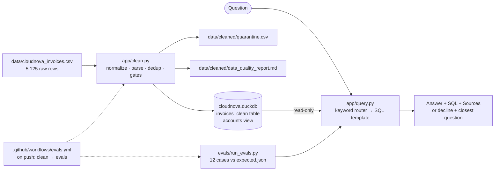

# Architecture

Data flows left to right. Everything runs locally; no network calls, no API keys.

| Component | File | Spec |
|---|---|---|
| Config (paths, FX, list prices, AS_OF_DATE, gate values; env overrides) | `app/config.py` | CLAUDE.md |
| Cleaning pipeline: trim → exact dedup → normalize/parse → quarantine → near-dup → derive → gates → write | `app/clean.py` | `specs/schema.md` |
| Store: `invoices_clean` (5,000 rows, PK invoice_id), `accounts` view (3,815 rows) | `cloudnova.duckdb` | `specs/schema.md` §8 |
| Router: regex intents → 6 parameterized SQL templates, read-only | `app/query.py` | `specs/api.md` |
| CLI: `clean`, `ask` | `app/__main__.py` | `specs/api.md` |
| Eval harness | `evals/run_evals.py`, `evals/expected.json` | `specs/evals.md` |
| CI: rebuild + evals on push | `.github/workflows/evals.yml` | — |
